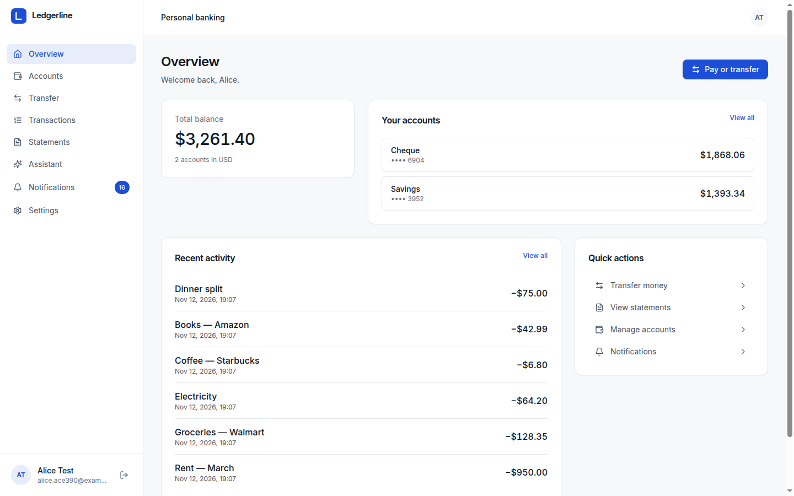
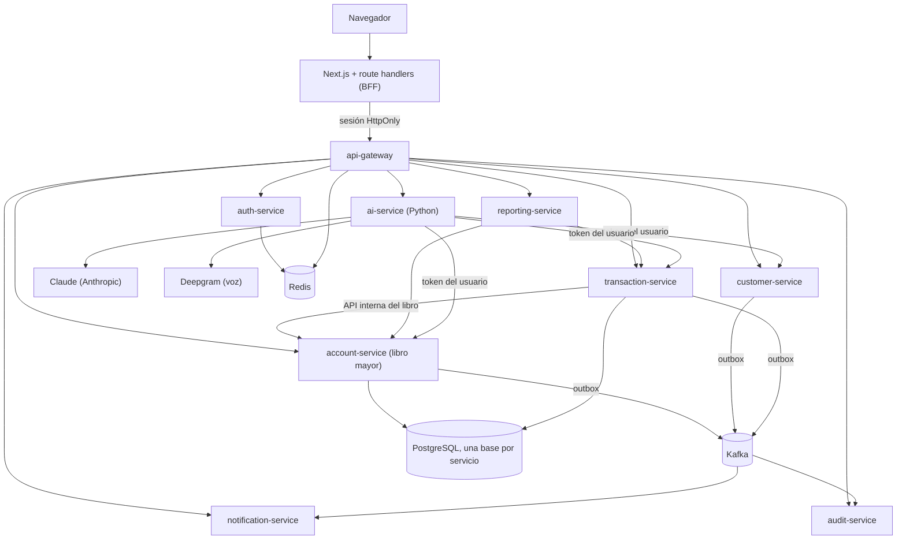
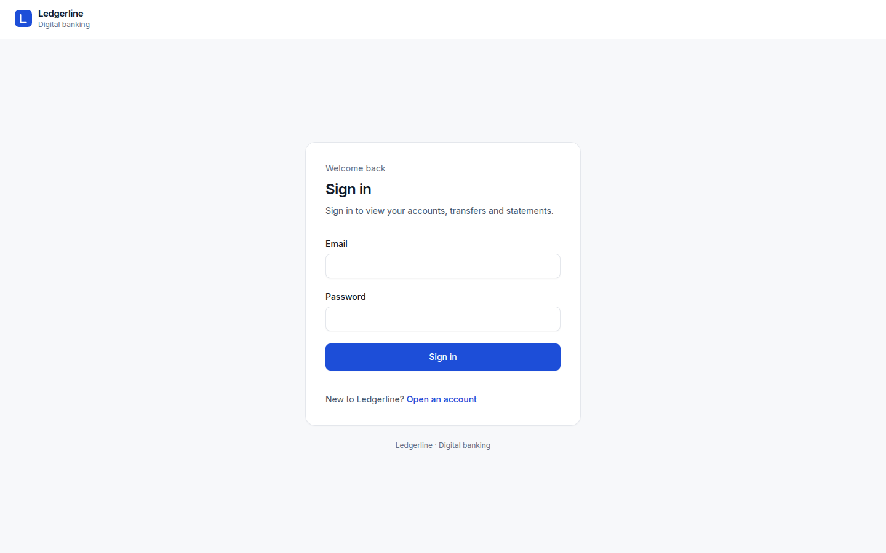
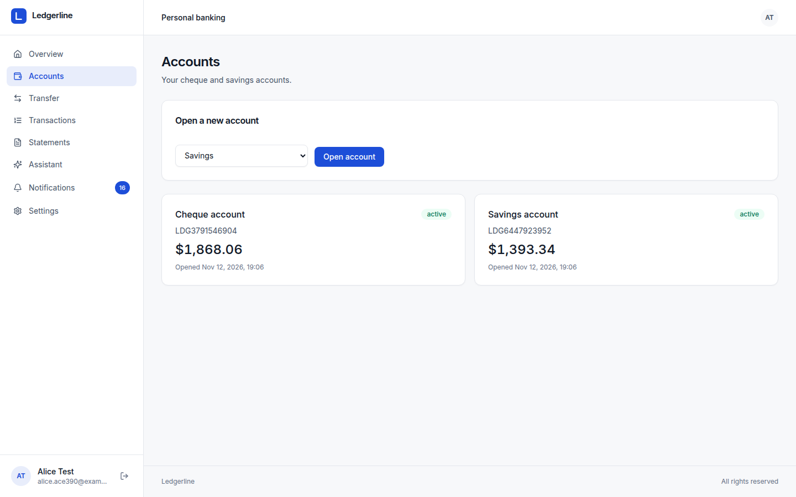
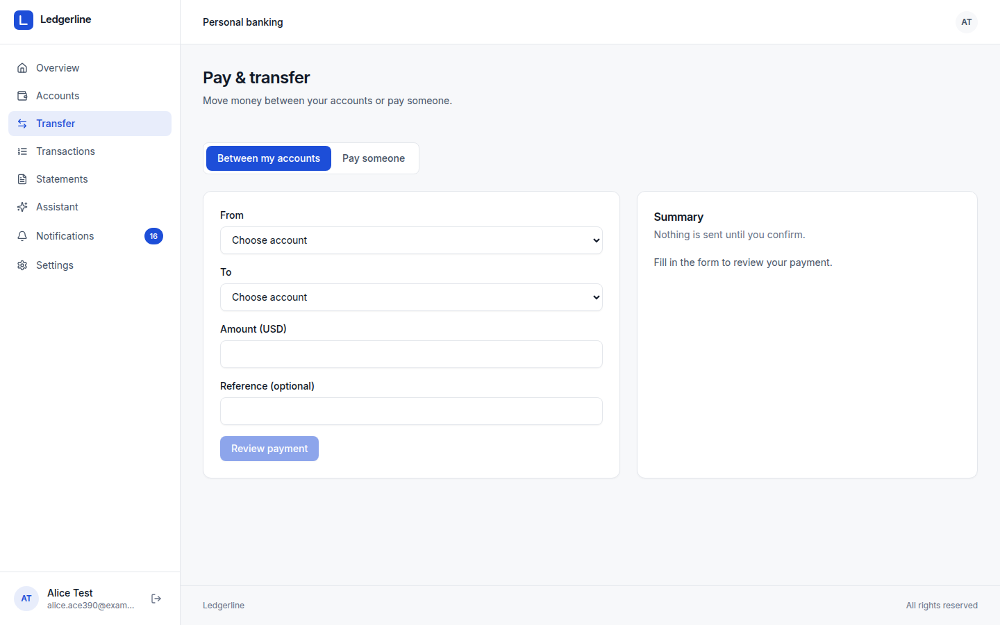
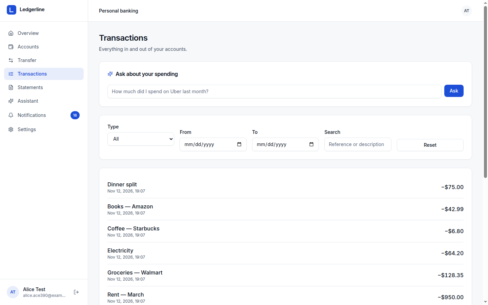
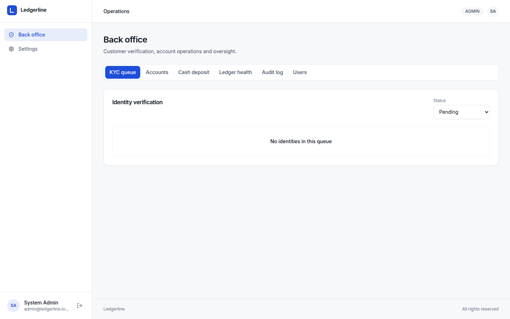
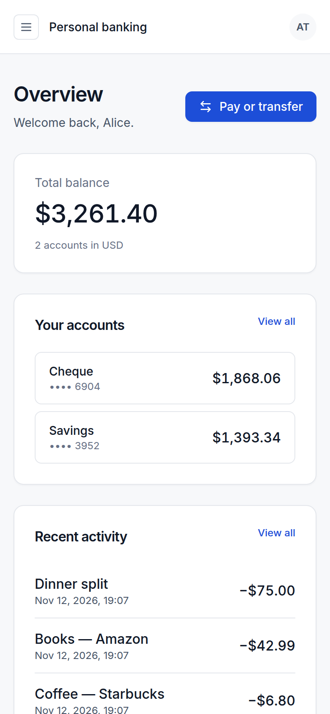

# Ledgerline

[English](README.md) · **Español**

Un banco digital construido como microservicios orientados a eventos: nueve servicios Spring Boot
y un servicio de IA en Python detrás de una única puerta de enlace, una aplicación web Next.js y un
libro mayor de partida doble que la propia base de datos hace cumplir. Se ejecuta en local con
Docker Compose y se despliega en AWS EKS con Helm y Terraform.

**Estado:** el backend compila y su suite de pruebas pasa con JDK 21 y Docker disponible. Los
manifiestos de despliegue y Terraform están completos, pero no se han aplicado a un clúster real.



*Inicio del cliente: saldo total, cuentas y actividad reciente. La interfaz sigue las guías de
producto de [docs/brand.md](docs/brand.md).*

## Contenido

- [Qué hace](#qué-hace)
- [Arquitectura](#arquitectura)
- [Cómo se mueve el dinero](#cómo-se-mueve-el-dinero)
- [Modelo de seguridad](#modelo-de-seguridad)
- [Funciones de IA](#funciones-de-ia)
- [Estructura del repositorio](#estructura-del-repositorio)
- [Inicio rápido](#inicio-rápido)
- [Desarrollo local](#desarrollo-local)
- [Servicios](#servicios)
- [Resumen de la API](#resumen-de-la-api)
- [Pruebas y calidad](#pruebas-y-calidad)
- [Despliegue](#despliegue)
- [Tecnologías](#tecnologías)
- [Capturas](#capturas)
- [Limitaciones conocidas](#limitaciones-conocidas)
- [Licencia](#licencia)

## Qué hace

**Para clientes**

- Registro y verificación de identidad (el número de documento se valida en el cliente y en el
  servidor).
- Apertura de cuentas corrientes y de ahorro una vez verificado.
- Transferencias entre cuentas propias o pago a cualquier cuenta Ledgerline por número de cuenta.
  Pagar a una cuenta nueva pide la contraseña de nuevo (step-up).
- Límites por pago (50.000 USD) y diarios (100.000 USD).
- Búsqueda de movimientos por tipo, fecha y texto, o en lenguaje natural ("¿cuánto gasté en Uber el
  mes pasado?").
- Extractos de cualquier periodo, con saldos inicial y final tomados del libro mayor, listos para
  imprimir o guardar en PDF.
- Bandeja de notificaciones en la app, resumen mensual de gastos y un asistente al que se puede
  escribir o hablar. El asistente puede preparar un pago; solo el cliente puede confirmarlo.

**Para el personal (back office)**

- Cola de revisión KYC (aprobar o rechazar).
- Operaciones sobre cuentas: congelar, descongelar, cerrar.
- Depósitos en efectivo de sucursal.
- Salud del libro mayor: conciliación en vivo de cada saldo contra sus asientos.
- Registro de auditoría de cada evento de dominio.
- Gestión de roles (un administrador no puede cambiar su propio rol).

## Arquitectura



Cómo fluye una petición:

1. El navegador solo habla con la aplicación Next.js en su propio origen. Los route handlers
   guardan la sesión en cookies HttpOnly y reenvían las llamadas a la puerta de enlace.
2. La puerta de enlace valida el JWT del usuario, consulta la lista de revocación, elimina cualquier
   cabecera de identidad enviada por el cliente, aplica límites por usuario y añade un token interno
   firmado de 60 segundos.
3. Cada servicio verifica ese token interno y aplica reglas de rol y propiedad. Las llamadas entre
   servicios llevan su propio token firmado: uno con alcance de usuario, o uno `SERVICE` para las
   llamadas internas al libro mayor.
4. Los cambios de estado que interesan a otros se escriben en un outbox dentro de la misma
   transacción de base de datos y se publican en Kafka. Los consumidores reintentan con backoff y
   aparcan los registros inválidos en un topic de mensajes muertos.

## Cómo se mueve el dinero

`account-service` es el único dueño del dinero:

- **Partida doble e inmutable.** Cada movimiento es un asiento de apuntes que suman cero. Un
  trigger de restricción diferida rechaza cualquier asiento que no cuadre, y los apuntes no se
  pueden actualizar ni borrar. Las correcciones son asientos inversos.
- **Cuentas de sistema.** Los depósitos y retiros en efectivo se registran contra `CASH_CLEARING`,
  así el dinero nunca aparece de la nada. Los clientes no pueden depositar; el personal de sucursal
  registra el efectivo.
- **Bloqueado e idempotente.** Un asiento bloquea las cuentas que toca (por orden de id, para evitar
  interbloqueos), comprueba estado, moneda y saldo disponible, y escribe los apuntes y la proyección
  de saldo en una sola transacción. Los asientos se indexan por la clave de idempotencia del
  llamador, de modo que un reintento nunca contabiliza dos veces.
- **Transferencias a prueba de caídas.** `transaction-service` registra cada instrucción como
  `PENDING` antes de llamar al libro. Un trabajo de recuperación reintenta las instrucciones
  `PENDING` antiguas con la misma clave, así que una caída en cualquier punto termina en un único
  resultado. Una transferencia interna es un solo asiento atómico, no una saga por pasos.
- **Conciliación.** Un trabajo nocturno (también disponible en vivo en el back office) comprueba que
  todos los apuntes suman cero y que cada saldo coincide con la suma de sus apuntes.

## Modelo de seguridad

- **Sin tokens en JavaScript.** Los tokens de acceso y refresco son cookies HttpOnly con
  `SameSite=Strict`. Los refresh rotan y son de un solo uso, y cerrar sesión revoca ambos tokens en
  el servidor.
- **CSRF y XSS.** Toda mutación exige un `Origin` del mismo sitio más una cabecera personalizada. Se
  aplica una Content Security Policy estricta (`connect-src 'self'`, `frame-ancestors 'none'`). El
  texto de terceros (referencias de pago, salida del modelo) se muestra siempre como texto plano.
- **Step-up.** Pagar a una cuenta nueva exige reescribir la contraseña. Los pagos que prepara el
  asistente siempre la necesitan.
- **Confianza cero entre servicios.** Las cabeceras de identidad en crudo se ignoran. Solo se
  aceptan tokens internos firmados, y `/internal/**` exige el rol `SERVICE`.
- **Cuentas.** Las contraseñas deben tener 12 caracteres o más con tipos mezclados. El inicio de
  sesión se bloquea 15 minutos tras fallos repetidos, y un correo desconocido tarda lo mismo en
  rechazarse que uno conocido.
- **Sin secretos por defecto.** Cada secreto viene del entorno. `scripts/dev-secrets.sh` genera los
  locales en un `.env` ignorado por git, y Helm se niega a renderizar sin ellos.
- **Red.** Docker Compose publica solo la web y la puerta de enlace, ambas en `127.0.0.1`. Helm añade
  una NetworkPolicy de denegación por defecto. Los contenedores corren como no-root sin escalada de
  privilegios, y los de IA y web usan sistemas de archivos de solo lectura.
- **CI.** CodeQL (Java, TypeScript, Python), escaneo de dependencias y configuraciones con Trivy, y
  escaneo de secretos con Gitleaks en cada push.

## Funciones de IA

Un servicio Python aparte (`ai/`: FastAPI, Pydantic v2, uv, pyright) construido sobre estas reglas:

- **El libro mayor es la fuente de verdad.** Los modelos nunca hacen aritmética con dinero; los
  totales salen de SQL o de `Decimal`, y el modelo solo escribe palabras alrededor.
- **Mínima autonomía.** Por defecto se usa un flujo de trabajo. El único agente abierto es el
  asistente, y no puede mover dinero.
- **La autorización vive en las herramientas.** Cada llamada se ejecuta con un token emitido para el
  usuario autenticado, así que el modelo nunca ve ni hace más que el cliente en la app.

| Función | Cómo funciona | Modelo |
|---|---|---|
| Categorización de movimientos | Reglas primero, modelo para la cola larga, la baja confianza va a revisión | Claude Haiku |
| Búsqueda en lenguaje natural | El modelo rellena un filtro tipado; la API lo aplica; los totales se calculan en código | Claude Haiku |
| Respuestas de ayuda | Documentos de políticas en un prompt cacheado con citas; sin cita, "contacta a soporte" | Claude Sonnet |
| Resumen mensual | Los hechos se calculan en código; el modelo redacta; una comprobación determinista descarta cifras que no estén en los hechos | Claude Sonnet |
| Asistente | Herramientas estrechas, tipadas y con alcance de usuario; los pagos se convierten en propuestas que el cliente confirma con step-up | Claude Sonnet / Opus |
| Voz | Deepgram voz a texto → el mismo asistente → Deepgram texto a voz; el audio nunca se almacena | Deepgram Nova / Aura |

**Defensas contra inyección de prompt.** Las referencias de pago las escribe quien envía el dinero,
así que se tratan como hostiles:

- Se filtran y se envuelven como datos no confiables antes de que el modelo las vea.
- Un beneficiario que el cliente no escribió se marca en la tarjeta de confirmación.
- Los enlaces e imágenes de la salida se eliminan.
- Los identificadores personales se enmascaran antes de que el texto llegue a un proveedor.
- Cada usuario tiene un tope diario de gasto.

**Evaluaciones.** `ai/evals` contiene conjuntos dorados versionados (categorización, búsqueda, ayuda,
asistente) con evaluadores deterministas, umbrales por suite en `thresholds.json` y una puerta en CI
(`.github/workflows/ai-evals.yml`). La suite del asistente incluye escenarios de red team.

Las funciones de IA son opcionales: sin `ANTHROPIC_API_KEY` el servicio se declara no disponible y el
resto del banco funciona con normalidad.

## Estructura del repositorio

```
server/           nueve servicios Spring Boot, la puerta de enlace, Eureka y una librería compartida (Maven)
ai/               el servicio de IA en Python (uv)
client/           la aplicación Next.js, con route handlers como BFF
helm/ledgerline   chart Helm paraguas, un subchart por servicio
terraform/        EKS/RDS/MSK: un stack de producción y otro Spot más barato
scripts/          secretos locales, creación de bases, el recorrido de extremo a extremo
docs/             capturas y documentación adicional
```

## Inicio rápido

Requisitos: Docker con Compose v2 (8 GB de memoria asignada) y `openssl` para generar secretos.

```bash
cp .env.example .env
sh scripts/dev-secrets.sh          # genera secretos locales en .env (nunca se imprimen)
# opcional: añade ANTHROPIC_API_KEY y DEEPGRAM_API_KEY a .env para las funciones de IA
docker compose up --build
```

| Qué | URL |
|------|-----|
| Aplicación web | http://localhost:3000 |
| Puerta de enlace | http://localhost:8080 |
| Panel de Eureka | http://localhost:8761 |

En el primer arranque se crea un administrador: `admin@ledgerline.local`, con la contraseña
guardada como `ADMIN_PASSWORD` en tu `.env`.

Para probar el recorrido completo:

1. Registra un cliente y completa el onboarding.
2. Entra como administrador, aprueba al cliente en **Back office → KYC queue** y registra un depósito
   en efectivo.
3. Como cliente, abre una segunda cuenta y transfiere entre cuentas.
4. Paga el número de cuenta de otro cliente y genera un extracto.

## Desarrollo local

**Se requiere JDK 21.** Lombok 1.18.36 no compila con JDK 22 o superior: el build falla con
`ExceptionInInitializerError: TypeTag :: UNKNOWN`. Maven Enforcer comprueba la versión y falla con un
mensaje claro, y `.sdkmanrc` la fija para usuarios de SDKMAN. Node 20+ y Python 3.12+ son necesarios
para las otras dos aplicaciones (`.nvmrc` fija Node 20).

```bash
docker compose up postgres kafka redis     # infraestructura en 127.0.0.1:5433 / 9092 / 6380

cd server
./mvnw clean install -DskipTests           # wrapper de Maven, JDK 21

cd ../ai
uv sync && uv run uvicorn ledgerline_ai.main:app --port 8090

cd ../client
npm ci && npm run dev                      # define API_URL y SESSION_SECRET en client/.env.local
```

Cada servicio tiene su propia base (`ledgerline_auth`, `ledgerline_customer`, `ledgerline_account`,
`ledgerline_transaction`, `ledgerline_notification`, `ledgerline_audit`, `ledgerline_reporting`). El
perfil `test` acepta `DB_URL` para sobrescribir un servicio concreto y `POSTGRES_TEST_PORT` para
apuntar todos a un puerto distinto (la base de Compose escucha en 5433). Sin ninguno de los dos, el
servicio conecta a `jdbc:postgresql://localhost:5432/ledgerline_<servicio>`.

## Servicios

| Servicio | Puerto | Responsabilidad |
|---------|------|----------------|
| `api-gateway` | 8080 | Único punto de entrada: validación de JWT, revocación, eliminación de cabeceras, tokens internos, límites |
| `auth-service` | 8081 | Registro, inicio de sesión con bloqueo, refresh rotatorio, revocación, roles |
| `customer-service` | 8082 | Perfiles de cliente y estado KYC |
| `account-service` | 8083 | Cuentas y libro mayor de partida doble, conciliación, saldo en cualquier momento |
| `transaction-service` | 8084 | Depósitos, retiros y transferencias (PENDING → COMPLETED/FAILED), límites, búsqueda |
| `notification-service` | 8085 | Bandeja en la app a partir de eventos de dominio; punto de extensión para email |
| `audit-service` | 8086 | Registro de auditoría append-only y deduplicado de cada evento |
| `reporting-service` | 8087 | Extractos que cuadran con el libro mayor |
| `ai-service` | 8090 | Categorización, búsqueda, ayuda, resumen, asistente, voz |
| `discovery-service` | 8761 | Registro Eureka (Compose; Kubernetes usa Services) |
| `frontend` | 3000 | Aplicación Next.js 15 con route handlers como backend-for-frontend |

## Resumen de la API

Todas las rutas están detrás de la puerta de enlace. Los `POST` que mueven dinero exigen la cabecera
`Idempotency-Key`.

| Área | Endpoints |
|------|-----------|
| Auth | `POST /api/v1/auth/{register,login,refresh,logout}`, `GET /api/v1/auth/users`, `PUT /api/v1/auth/users/{id}/role` |
| Clientes | `POST /api/v1/customers`, `GET /api/v1/customers/me`, `PUT /api/v1/customers/{id}`, `GET /api/v1/customers?kycStatus=`, `PATCH /api/v1/customers/{id}/kyc` |
| Cuentas | `POST /api/v1/accounts`, `GET /api/v1/accounts`, `GET /api/v1/accounts/{id}`, `GET /api/v1/accounts/{id}/balance?at=`, `GET /api/v1/accounts/customer/{id}`, `PATCH /api/v1/accounts/{id}/{freeze,unfreeze,close}`, `GET /api/v1/accounts/admin/reconciliation` |
| Movimientos | `POST /api/v1/transactions/{deposit,withdraw}`, `GET /api/v1/transactions/mine`, `GET /api/v1/transactions/account/{id}?type=&from=&to=&q=`, `GET /api/v1/transactions/{id}` |
| Transferencias | `POST /api/v1/transfers` (`targetAccountId` o `targetAccountNumber`), `GET /api/v1/transfers/{id}` |
| Notificaciones | `GET /api/v1/notifications`, `GET /api/v1/notifications/unread-count`, `PATCH /api/v1/notifications/{id}/read`, `POST /api/v1/notifications/read-all` |
| Extractos | `POST /api/v1/reports/statements`, `GET /api/v1/reports/statements/{id}`, `GET /api/v1/reports/statements/{account,customer}/{id}` |
| Auditoría | `GET /api/v1/audit`, `GET /api/v1/audit/{id}`, `GET /api/v1/audit/aggregate/{type}/{id}` |
| IA | `POST /api/v1/ai/{assistant,search,help,categorize,voice}`, `GET /api/v1/ai/insights`, `GET /api/v1/ai/proposals/{id}` |

Cada servicio Java sirve además su OpenAPI en `/swagger-ui.html` en su propio puerto, accesible solo
desde dentro de la red de Docker.

## Pruebas y calidad

```bash
# Una vez: bases para los tests de carga de contexto
sh scripts/create-test-databases.sh

# Java: unitarios, seguridad e integración con Testcontainers
cd server && ./mvnw verify -Dspring.profiles.active=test -Deureka.client.enabled=false

cd ../ai && uv run pytest && uv run pyright && uv run ruff check .
cd ../ai && uv run python -m evals.run --trials 3   # evaluaciones con modelo real (requiere ANTHROPIC_API_KEY)
cd ../client && npm run lint && npm run typecheck && npm run build
python scripts/e2e_journey.py                       # recorrido de extremo a extremo contra el stack
```

Lo más relevante:

- Un recorrido de extremo a extremo (`scripts/e2e_journey.py`, ~40 aserciones) comprueba el stack:
  registro, KYC, depósitos, transferencias, reintentos idempotentes, límites, acceso entre clientes,
  cabeceras falsificadas, rutas internas, conciliación, extractos, notificaciones, endpoints de IA y
  las protecciones de cookies, CSRF, step-up y CSP de la web.
- Pruebas de integración del libro contra Postgres real: reintentos idempotentes, rechazo de
  sobregiros, 50 retiros concurrentes que nunca sobregiran y rechazo a nivel de base de asientos
  descuadrados o editados.
- Pruebas de seguridad: se rechazan cabeceras de identidad falsificadas y tokens internos forjados,
  los endpoints internos rechazan incluso a administradores y los clientes sin verificar no pueden
  abrir cuentas.
- Las pruebas de IA corren sin red con modelo y banco falsos. Cubren la inyección (una referencia de
  pago maliciosa), propuestas ligadas a su dueño, el límite de pasos y la verificación de tokens.

Notas sobre las pruebas:

- Las pruebas que necesitan Docker (Testcontainers) se omiten cuando la JVM no alcanza el daemon. En
  Linux el usuario debe estar en el grupo `docker`, o `DOCKER_HOST` debe apuntar al socket.
- Las pruebas de carga de contexto necesitan PostgreSQL con una base por servicio; el script anterior
  las crea y encuentra `psql` o un contenedor Postgres en marcha (usa `PG_CONTAINER=<nombre>` si el
  contenedor tiene otro nombre, y `PGPORT` si no está en 5432). La CI crea el mismo conjunto antes de
  ejecutar la suite.

CI (`.github/workflows/`): build y pruebas Java con Spotless y Checkstyle, lint, tipos y pruebas de
IA, lint, tipos y build del cliente, lint de Helm, builds Docker de las 11 imágenes, CodeQL, Trivy,
Gitleaks y la puerta de evaluaciones de IA.

## Despliegue

| Entorno | Infraestructura | Disparador |
|-------------|----------------|---------|
| Local | Docker Compose (puertos sobrescribibles con `GATEWAY_HOST_PORT`, `WEB_HOST_PORT`, `POSTGRES_HOST_PORT`, ...) | `docker compose up` |
| Staging | EKS con Postgres, Redis y Kafka en el clúster vía Helm | Push a `main` |
| Producción | EKS con RDS, ElastiCache y MSK | `workflow_dispatch` manual con interruptores por servicio |

`helm/ledgerline` es un chart paraguas: un subchart por servicio más configuración compartida. Los
secretos son valores obligatorios, o vienen de AWS Secrets Manager mediante recursos
`ExternalSecret`. Los pods corren como no-root con perfil seccomp, y una NetworkPolicy de denegación
por defecto solo admite tráfico externo hacia la puerta de enlace y el frontend.

```bash
helm upgrade --install ledgerline ./helm/ledgerline \
  --namespace ledgerline --create-namespace \
  --set global.jwt.secret=... --set global.internalJwt.secret=... --set global.postgres.password=...
```

Terraform vive en `terraform/aws-eks-production` (VPC en tres AZ, EKS, RDS Multi-AZ, ElastiCache,
MSK, ECR, controlador ALB, External Secrets) y `terraform/aws-eks-cheap` (un clúster Spot para
experimentos). El trabajo de despliegue solo se ejecuta cuando la variable del repositorio
`DEPLOY_ENABLED` vale `"true"`; los valores de ejemplo en `terraform.tfvars.example` son marcadores y
ningún entorno se ha aplicado todavía.

## Tecnologías

| Área | Tecnologías |
|------|--------------|
| Backend | Java 21, Spring Boot 3.5, Spring Cloud Gateway, Spring Security, Spring Data JPA, Flyway, MapStruct, Kafka, Redis, PostgreSQL 16 |
| IA | Python 3.13, FastAPI, Pydantic v2, SDK de Anthropic, Deepgram, OpenTelemetry, Prometheus |
| Frontend | Next.js 15 (App Router, route handlers como BFF), React 19, TypeScript, Tailwind CSS, TanStack Query, Zod |
| Calidad | JUnit 5, Testcontainers, pytest, pyright, ruff, ESLint, Spotless, Checkstyle, CodeQL, Trivy, Gitleaks |
| Entrega | Docker Compose, Helm, Terraform (AWS EKS, RDS, ElastiCache, MSK), GitHub Actions |

## Capturas

| | |
|---|---|
|  |  |
| Inicio de sesión: correo y contraseña | Cuentas: saldos y números de cuenta |
|  |  |
| Transferencia con revisión y step-up | Movimientos con filtros y búsqueda |
|  |  |
| Back office: KYC, cuentas, efectivo, libro | Vista general en 390 px |

## Limitaciones conocidas

- MFA (TOTP o passkeys), beneficiarios guardados, pagos programados y tarjetas aún no están
  construidos. El step-up con contraseña protege los pagos a beneficiarios nuevos mientras tanto.
- El envío de email es solo una interfaz de registro; las notificaciones son en la app.
- Los tokens entre servicios usan una clave HMAC compartida. Está previsto pasar a RS256 con JWKS y
  mTLS entre pods.
- Algunos servicios aún guardan marcas de tiempo locales sin zona horaria; el libro y las
  transacciones usan `timestamptz`.
- El copiloto de soporte, el modelo de puntuación de fraude y el canal de voz telefónico no están
  construidos.
- `api-gateway`, `notification-service`, `audit-service` y `reporting-service` no tienen pruebas, y
  el cliente web tampoco; la cobertura se concentra en el libro y la seguridad.
- La observabilidad termina en métricas de Prometheus y health checks: los servicios Java no tienen
  trazas distribuidas y no hay paneles ni alertas.

## Licencia

MIT. Ver [LICENSE](LICENSE).
